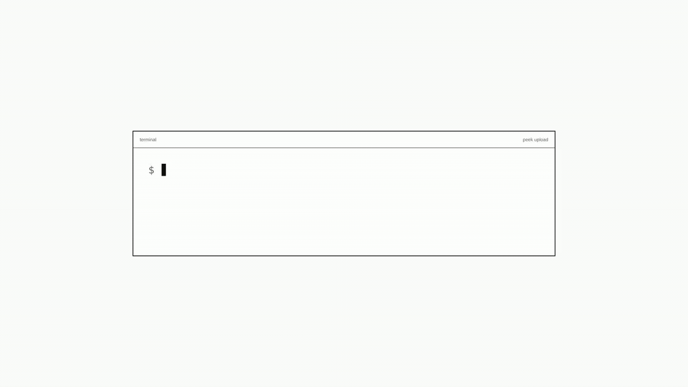

<h1>
  
</h1>

[](https://github.com/andras-tkcs/peek/actions/workflows/ci.yml) [](https://github.com/andras-tkcs/peek/releases) [](LICENSE) [](go.mod)


Share an HTML page inside your company, get a link, and collect feedback directly on the page.

Peek is a self-hosted internal review tool for HTML reports, prototypes, build artifacts, and agent-generated pages. Upload a file from the CLI or dashboard, share the preview URL, and let reviewers leave comments pinned to elements, anchored to selected text, or attached to the whole page. It ships as a single static Go binary with pure-Go SQLite and no CGO.



## Quick start

```sh
# 1. Start the server (first run prints a setup URL)
peekd --addr :7700 --data ./data --base-url http://localhost:7700

# 2. Open the setup URL from the server logs and create the first admin.

# 3. Log in (or create an API key under Dashboard → API keys)
peek login --host http://localhost:7700

# 4. Share a page (restricted by default: only you, admins and people you grant)
peek upload mypage.html
#  -> http://localhost:7700/p/mypage-html-k7m2xq
peek grant mypage-html-k7m2xq alice@example.com    # emails Alice the link when SMTP is configured

# Or make it open to anyone with the link
peek upload mypage.html --visibility public
```

Common follow-up commands:

```sh
peek list
peek stats mypage-html-k7m2xq
peek comments mypage-html-k7m2xq
peek comments mypage-html-k7m2xq --version 2
peek upload mypage.html --slug mypage-html-k7m2xq   # new version at /p/mypage-html-k7m2xq/v/2
peek versions mypage-html-k7m2xq
peek grant mypage-html-k7m2xq alice@example.com    # for --visibility restricted pages
peek visibility mypage-html-k7m2xq restricted
peek visibility mypage-html-k7m2xq public
peek delete mypage-html-k7m2xq
peek export mypage-html-k7m2xq
```

## Install

**Prebuilt binaries** (recommended): grab a `peekd` + `peek` archive for your OS/arch from the [releases page](https://github.com/andras-tkcs/peek/releases).

**CLI one-liner:**
```sh
curl -fsSL https://raw.githubusercontent.com/andras-tkcs/peek/main/install.sh | sh
```
Override with `PEEK_VERSION` / `PEEK_INSTALL_DIR`. `install.sh` verifies the archive against the release's `checksums.txt` and refuses to install on mismatch; releases published before checksums were added (v0.8.1 and older) have no checksums file.

**Go install:**
```sh
go install github.com/andras-tkcs/peek/cmd/peekd@latest   # server
go install github.com/andras-tkcs/peek/cmd/peek@latest    # CLI
```

**Docker:**
```sh
docker run -d --name peek -p 7700:7700 \
  -v peek-data:/data \
  -e PEEK_BASE_URL=https://peek.example.com \
  ghcr.io/andras-tkcs/peek:latest
```
For production, pin a release tag (`ghcr.io/andras-tkcs/peek:<version>`) or an image digest (`ghcr.io/andras-tkcs/peek@sha256:…`). The `/data` volume holds the database, uploads, and signing key. On first run Peek prints a one-time setup URL. The image is `scratch`-based, multi-arch (`amd64`/`arm64`), runs as uid 65532.

```sh
docker compose up -d              # local stack
docker compose --profile s3 up -d # with MinIO storage
```

## Features

- **In-context review**: pinned, text-anchored, and page-level comments with numbered on-page markers. Click a comment to jump back to its anchor.
- **Safe HTML previews**: uploaded pages render in a sandboxed iframe (`sandbox="allow-scripts"`, no `allow-same-origin`) so they cannot read Peek cookies, call the server as the user, or touch the parent page.
- **Terminal and browser workflows**: upload, list, delete, change visibility, inspect comments, and view stats from the CLI or web dashboard.
- **Access controls for internal teams**: public links, signed-in-user pages (any active Peek account), restricted pages (the default) with per-user and Google group grants and a notification email to each new grantee, page versions, first-run admin setup, local login, invite-only Google/GitHub/OIDC OAuth, Google org sign-in (no invites), allowed login email domain, token expiry, and admin-managed users.
- **Operational basics included**: health/readiness checks, structured JSON logging, Prometheus metrics, audit log, quota and retention controls, consistent SQLite backup, file or S3-compatible storage, and S3 endpoint SSRF protection.
- **Small deployment footprint**: one static Go binary, pure-Go SQLite, no runtime dependencies.

Peek is not a SaaS product. It avoids billing, public multi-tenant onboarding, marketplace workflows, and growth-oriented product surfaces.

## Commenting

Open `/p/<slug>` and use the floating island at the bottom:

1. Select text in the page, then click the Comment bubble to anchor a comment to that quote.
2. Click Comment, then click any element to pin a comment to it.
3. Or leave a page-level note not tied to anything.

Comments live in a side panel. Your name is asked once and remembered. Public pages are open to anyone with the link, signed-in pages require an active Peek account, and restricted pages require an account matching a grant. Comments belong to the version they were written on.

## CLI reference

```
peek login [--host <url>]              browser login when available; token fallback
peek login --token-stdin               read an access token from stdin
peek login --token-file <path>         read an access token from a file
peek config set --host <url>           set the configured server
peek config show                       show current host + masked token
peek upload <file.html> --visibility public [--name <filename>]
peek upload <file.html> --visibility signed-in [--name <filename>]
peek upload <file.html> --visibility restricted [--name <filename>]
peek upload <file.html> --slug <slug>   upload a new version of an existing page
peek list
peek delete <slug>
peek delete-all                        delete all your uploads
peek visibility <slug> public          make an upload link-accessible
peek visibility <slug> signed-in      require a Peek account
peek visibility <slug> restricted      only the owner, admins and grantees
peek rename <slug> <new name>         rename; old links redirect
peek grant <slug> <email> [--group]    give a user (or Google group) access
peek revoke <slug> <email> [--group]   remove a grant
peek grants <slug>                     list grants on a page
peek versions <slug>                   list versions of a page
peek stats <slug>
peek comments <slug> [--version <n>]   list comments (latest version by default)
peek export <slug>                     export all data for an upload
peek token create --name <name>        create a user token (admin only)
peek token list                        list tokens (admin only)
peek token revoke <id>                 revoke a token by id (admin only)
peek version                           show version
```

Upload visibility is set at creation time with `--visibility public|signed-in|restricted`, and defaults to `restricted`. Use `peek visibility <slug> public` to make the link public, or `peek visibility <slug> signed-in` to require a Peek account (the old name `private` is still accepted). Restricted pages admit only the owner, admins and signed-in viewers matching a grant (`peek grant`); group grants need the `PEEK_GOOGLE_*` settings below. When an admin has configured SMTP on the **Email** tab of the Admin page, adding a grant, or switching a page to restricted, emails the grantees a link to the page. Page passwords were removed: existing password pages became restricted pages that only the owner and admins can open until they are shared. Re-uploading with `--slug` adds a version: `/p/<slug>` serves the latest and `/p/<slug>/v/<n>` any retained version. `peek rename <slug> <new name>` renames a page; its link follows the name and old links redirect. The dashboard's **Access** row action does all of this from the browser.

Login methods, most secure first: `peek login` (browser), `PEEK_TOKEN=...` env override for CI (with a key from Dashboard → API keys), `peek login --token-stdin`, then `peek login --token-file <path>`. The `--token <value>` flag still works where token login is allowed but warns because it leaks into shell history and process lists.

## Configuration

### Server (`peekd`)

| Flag | Env | Default | Description |
| --- | --- | --- | --- |
| `--addr` | `PEEK_ADDR` | `:7700` | Listen address |
| `--data` | `PEEK_DATA` | `./data` | Data dir (db + uploads + secret) |
| `--base-url` | `PEEK_BASE_URL` | `http://localhost:7700` | Public base URL. Use `https://…` in production for Secure cookies + HSTS. |
| `--max-upload` | `PEEK_MAX_UPLOAD` | `2097152` (2 MiB) | Max upload size in bytes |
| `--secret` | `PEEK_SECRET` | _(stored in data dir)_ | HMAC/encryption secret for multi-instance cookie/settings sharing. Or `PEEK_SECRET_FILE` with the path to a file (Docker/Kubernetes secrets); setting both the variable and `_FILE` is an error. |
| `--max-total-size` | `PEEK_MAX_TOTAL_SIZE` | `0` | Total upload storage limit in bytes (`0` = unlimited) |
| `--retention-days` | `PEEK_RETENTION_DAYS` | `0` | Auto-delete uploads older than N days (`0` = off) |
| `--trusted-proxy` | `PEEK_TRUSTED_PROXY` | `false` | Trust `X-Forwarded-For` for analytics/audit IPs |
| `--trusted-proxy-cidrs` | `PEEK_TRUSTED_PROXY_CIDRS` | `127.0.0.0/8,::1/128` | Proxies allowed to set `X-Forwarded-For` (with `--trusted-proxy`) |
| `--metrics-token` | `PEEK_METRICS_TOKEN` | _(empty)_ | Bearer token (at least 16 characters) for `/metrics`; when empty, an admin API token is required instead. Or `PEEK_METRICS_TOKEN_FILE` with the path to a file. |
| `--storage` | `PEEK_STORAGE` | `file` | Storage backend: `file` or `s3` |
| `--s3-endpoint` | `PEEK_S3_ENDPOINT` | _(empty)_ | S3-compatible endpoint URL |
| `--s3-bucket` | `PEEK_S3_BUCKET` | _(empty)_ | S3 bucket name |
| `--s3-region` | `PEEK_S3_REGION` | `us-east-1` | S3 region |
| `--s3-access-key` | `PEEK_S3_ACCESS_KEY` | _(empty)_ | S3 access key |
| `--s3-secret-key` | `PEEK_S3_SECRET_KEY` | _(empty)_ | S3 secret key. Or `PEEK_S3_SECRET_KEY_FILE` with the path to a file (Docker/Kubernetes secrets); setting both the variable and `_FILE` is an error. |
| `--s3-allow-private-endpoint` | `PEEK_S3_ALLOW_PRIVATE_ENDPOINT` | `false` | Allow private/link-local S3 endpoints for dev |
| `--google-sa-key-file` | `PEEK_GOOGLE_SA_KEY_FILE` | *(empty)* | Google service account JSON key for group grants (needs `--google-admin-email`) |
| `--google-admin-email` | `PEEK_GOOGLE_ADMIN_EMAIL` | *(empty)* | Workspace admin to impersonate for group lookups |
| `--google-group-cache-ttl` | `PEEK_GOOGLE_GROUP_CACHE_TTL` | `5m` | Group membership cache lifetime |
| `--oidc-allow-private-issuer` | `PEEK_OIDC_ALLOW_PRIVATE_ISSUER` | `false` | Allow HTTP/private OIDC issuers for local SSO testing |

Admins can update runtime settings from the **Admin** page (the **Admin** button next to **Sign out**): max upload size, total storage limit, per-token quotas, retention days, and S3 credentials. Changing the storage backend requires a restart.

`peekd --version` prints the version. `peekd backup [path]` writes a consistent SQLite snapshot via `VACUUM INTO`. `peekd healthcheck` checks `/healthz`.

### CLI (`peek`)

Config saved to `<user-config-dir>/peek/config.json`. Override per-command with `PEEK_HOST` / `PEEK_TOKEN`.

## Security model

| Threat | Mitigation |
| --- | --- |
| Anyone can upload | Every upload requires a valid API token or authenticated dashboard session. |
| Token theft from database | Tokens stored as SHA-256 hashes; plaintext shown only at creation. |
| Long-lived tokens | `peek login` tokens expire after 90 days; admin tokens can include an expiry; expired tokens are rejected. |
| Token leaking via terminal | `peek login` uses browser login; token fallback reads from hidden prompt/stdin/file. |
| Phished CLI login | The approval link carries no code: the user types it from their own terminal and sees the requesting IP, client and time before approving. |
| Offboarding | API tokens follow the allowed email domain and OAuth-required rules; disabling an account or **Sign out other sessions** ends dashboard sessions server-side. |
| OAuth token exposure | Provider tokens used only for profile lookup; not stored. |
| Session-cookie theft | Dashboard cookie is a signed reference that the server can revoke per account; `HttpOnly`, `SameSite=Strict`, `Secure` on https. |
| CSRF / clickjacking | Dashboard forms require CSRF tokens; CSP with `frame-ancestors 'none'`. |
| Credentials in clear | Secure cookies + HSTS on https. Server warns on non-local plain http. |
| Uploaded HTML harms host | Server never executes HTML, only streams bytes. |
| Uploaded HTML steals data | Rendered in `<iframe sandbox="allow-scripts allow-popups">` and served with CSP `sandbox allow-scripts allow-popups`, so it has an opaque origin even when the raw URL is opened directly; `/raw` refuses non-iframe loads (`Sec-Fetch-Dest`). |
| Cross-origin attacks | Parent and iframe communicate only via `postMessage`. |
| Bypassing page access | `/raw` requires a short-lived HMAC-signed view token bound to the HttpOnly visitor cookie, and re-checks page access on every load, so revoking a grant or changing visibility takes effect immediately. |
| Brute force / spam | Per-IP rate limits on login and comment posting, plus per-account sign-in failure limits. |
| Malicious content | HTML sniffed, binaries rejected, configurable `MaxBytesReader`; non-upload requests are capped at 64 KiB. |
| SSRF via S3 | Endpoints must be HTTP(S); private/link-local IPs blocked unless explicitly allowed. |
| Path traversal / SQLi / link guessing | Slugs are the page name plus a random 6-character suffix (fully random when the name has no letters or digits); all queries parameterized. |
| Password / IP leakage | Account passwords bcrypt-hashed; analytics IPs SHA-256 hashed. |

## Deployment

Run `peekd` behind a TLS-terminating reverse proxy with `--base-url https://peek.example.com`. Example with Caddy:

```
peek.example.com {
    reverse_proxy 127.0.0.1:7700
}
```

Set `--trusted-proxy` if your proxy forwards `X-Forwarded-For`, and `--trusted-proxy-cidrs` if it does not connect from localhost. Back up the `data/` directory.

For Render, Fly.io, Railway, Kubernetes, and stateless app platforms, read the [cloud deployment notes](docs/src/content/docs/deployment-platforms.md) before deploying. Peek needs durable storage mounted at `/data`; a managed container filesystem is not enough to preserve SQLite data, uploaded files, or the generated signing key.

Operational endpoints:

| Endpoint | Purpose |
| --- | --- |
| `/healthz` | Liveness check |
| `/readyz` | Readiness check |
| `/metrics` | Prometheus text metrics |

`/metrics` is never anonymous: send `Authorization: Bearer <token>` with the `--metrics-token` value (or `PEEK_METRICS_TOKEN_FILE`), or with an admin API token when no metrics token is set. Full deployment checklist: [docs/operations.md](docs/operations.md).

## Web dashboard

A browser dashboard at `/login` lists the pages you own and the restricted pages shared with you (by title, with an icon for owner, admin or view-only), and lets users upload (a file, pasted HTML, or an **Empty page** that you name and fill with versions later), and rename and delete pages, change their visibility and grants, view stats, and create, regenerate and revoke their own API keys. First run starts at a one-time `/setup` URL that creates the initial admin. Admins can enable Google, GitHub, or generic OpenID Connect SSO from the **Admin** page (the **Admin** button next to **Sign out**) and optionally restrict human login to one exact email domain. OAuth signups are invite-only unless Google org sign-in (the `auth_google_org_signup` setting) is on: admins create invite links, users accept with an enabled OAuth provider. The same verified email maps to the same account across providers. Admins can disable users, promote/demote admins, and edit runtime limits, retention, auth, S3 and SMTP email settings.

OAuth callback URLs:
```
https://peek.example.com/oauth/google/callback
https://peek.example.com/oauth/github/callback
https://peek.example.com/oauth/oidc/callback
```

## Agent skills

Coding agents (Claude Code, opencode, etc.) can install skills to share HTML and return a link:

```sh
npx skills add andras-tkcs/peek@peek -g -y
```

Two skills ship in this repo:

- **`peek`** (`skills/peek/SKILL.md`): consumer side -- install the CLI, upload HTML, get a link, read comments.
- **`peek-server`** (`skills/peek-server/SKILL.md`): run and administer a Peek server.

## Architecture

```
cmd/peekd/          server entrypoint
cmd/peek/           CLI entrypoint
internal/db/        SQLite store + schema
internal/models/    data types
internal/server/    HTTP server, handlers, auth, security
internal/cli/       CLI client + commands
internal/web/       Templates and embedded CSS/JS assets
skills/peek/        consumer agent skill
skills/peek-server/ server/admin agent skill
assets/             documentation media
scripts/            tooling
```

Runtime CSS/JS lives in `internal/web/assets` and is embedded by Go. The root `assets/` directory is documentation media only. See [docs/architecture.md](docs/architecture.md) for the package map.

## License

[MIT](LICENSE)
